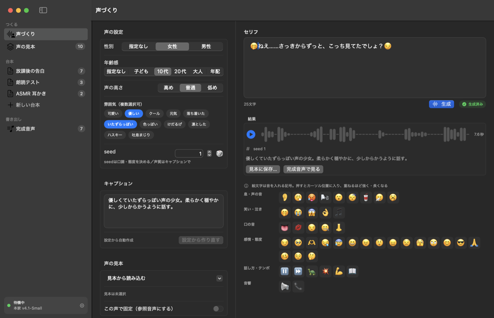
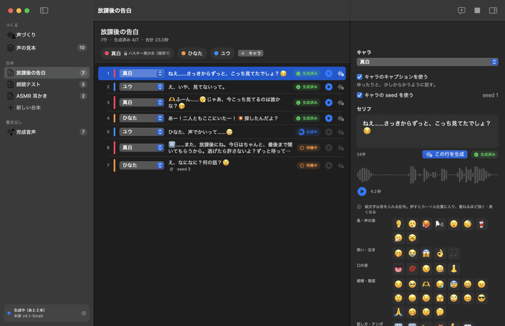

# Irodori Studio

日本語のローカル音声合成 [Irodori-TTS](https://huggingface.co/Aratako/Irodori-TTS-v4.1-Small) を、UI から扱う macOS アプリです。
声の設定からキャプション（声を指定する日本語の自然文）を組み立て、台本のセリフをまとめて音声にします。すべて手元の Mac で動き、外部に送信するものはありません。



## できること

- **声づくり** — 性別・年齢感・声の高さ・雰囲気（複数選択可）・seed を選ぶと、キャプションが自動で組み上がる。手で書き換えてもよい。セリフとキャプションは別の欄
- **絵文字の演技指導** — 公式の45種をボタンで並べ、押すとセリフのカーソル位置に挿入。同じ絵文字を重ねると効果が強く・長くなる
- **声の見本** — 気に入った声をキャプション＋seed＋音声として保存。選ぶと設定が入り、「この声で固定」にすると参照音声として使い、台本の全セリフを同じ声で焼ける
- **台本** — プロジェクトを複数持てる。登場キャラに声を割り当て、各行はキャラを選ぶだけ。行ごとにキャプションと seed の上書きも可能
- **完成音声** — 焼いた音声の一覧・試聴・Finder で表示・書き出し



## 必要なもの

- macOS 15 以降（Apple Silicon）と、Swift 6 が使える Xcode（開発したのは Xcode 27・Swift 6.4）
- [Irodori-TTS](https://github.com/Aratako/Irodori-TTS) のリポジトリと、その **Python 3.11** の仮想環境
  - 3.10 だと scipy が読み込めず、3.12 だと sentencepiece が入らない
  - 例: `cd Irodori-TTS && uv sync --extra cpu --python 3.11`
- モデルは初回の読み込み時に Hugging Face から自動で取得されます（`Aratako/Irodori-TTS-v4.1-Small` と音声コーデック `Aratako/Semantic-DACVAE-Japanese-32dim`）

## 使い方

```bash
./scripts/make_app.sh
open build/IrodoriStudio.app
```

Irodori-TTS の置き場所は、既定で `~/dev/github/Irodori-TTS` を見ます。別の場所にあるときは、アプリの設定画面でリポジトリと Python のパスを変えてください。

起動時のオプション:

| 引数 | 意味 |
|---|---|
| `--args -mock` | 音声合成を繋がず、ダミー音声で画面だけ動かす（デザイン確認用） |
| `--args -screen voiceDesign\|references\|project1\|newProject\|clips` | 開く画面を指定する |

## しくみ

Swift から PyTorch は直接呼べないので、Python を**常駐プロセス**として起動し、標準入出力で JSON を1行ずつやり取りします。モデルを載せっぱなしにできるので、2本目以降は待たされません。

```
SwiftUI (IrodoriStudio)
  └─ IrodoriKit … データの形・キャプションの組み立て・絵文字・SpeechSynthesizer プロトコル
       ├─ MockSpeechSynthesizer   … ダミー音声（-mock 起動時）
       └─ PythonSpeechSynthesizer … python/irodori_worker.py と会話する
```

- やり取りの約束事: [python/PROTOCOL.md](python/PROTOCOL.md)
- 生成は1本ずつ順番に行います（MPS は同時に複数の生成を走らせられないため）
- 1回の生成は30秒まで。長いセリフは句点で 70〜150 字ずつに分けると安定します
- 台本・声の見本・完成音声は `~/Library/Application Support/IrodoriStudio/library.json` に自動保存され、焼いた wav は同じフォルダの `Outputs/` に入ります

参考（M4 Pro・24GB）: モデルの読み込み 約12秒（2回目以降は即時）、1本あたり 3〜5秒。

## 注意

- 音声合成モデルの利用条件として、**本人の同意がない声のクローンは禁止**されています。参照音声は自分の声か、権利を持っているものを使ってください
- 出力の wav には電子透かし（SilentCipher）が入ります
- `Resources/DummyAudio/` の音声は、`-mock` で画面を動かすためのサンプルです（このモデルで生成したもの）

## ライセンス

MIT License（[LICENSE](LICENSE)）。音声合成モデルと Irodori-TTS 本体のライセンスは、それぞれの配布元に従ってください。
